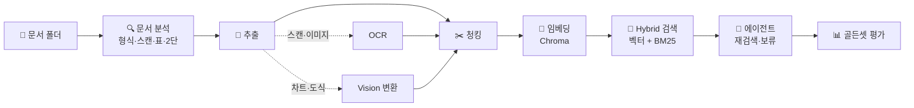

# 🧰 Personal Agent Skills

> 공부하고, 기록하고, 취업 준비하고, 만들어 보는 일을 돕는 **Codex · Claude Code 호환 개인 스킬 모음**

| 스킬 | 호출 | 한 줄 소개 |
|---|---|---|
| 📝 [**TIL 정리**](til/SKILL.md) | `$til` | 학습 자료를 노션 · TIL 레포 마크다운 · 티스토리 HTML로 한 번에 정리 |
| ✍️ [**자기소개서**](cover-letter-writing/SKILL.md) | `$cover-letter-writing` | 채용공고와 실제 경험을 연결해 자기소개서 작성 · 첨삭 |
| 🤖 [**RAG 에이전트 만들기**](rag-agent-builder/SKILL.md) | `$rag-agent-builder` | 문서 폴더를 분석해 추출부터 골든셋 평가까지 RAG 파이프라인 구축 |

---

## 🚀 빠르게 시작하기

```powershell
git clone https://github.com/snail5039-code/personal-agent-skills.git
cd personal-agent-skills
.\install.ps1          # Codex skills 폴더에 전부 설치
```

설치 후 Codex에서 스킬 이름 앞에 `$`를 붙여 부르면 된다.
스킬 이름을 쓰지 않아도 요청 내용에 따라 자동으로 선택될 수 있지만, 확실히 적용하려면 호출명을 쓴다.

---

## 📝 TIL 정리 · `$til`

부트캠프 학습 자료(파일 또는 붙여넣은 본문)를 내 TIL 양식으로 정리해 **세 가지 형태로 동시에** 만든다.

| 출력 | 내용 |
|---|---|
| ① 노션 페이지 | 개인 노션에 바로 정리 |
| ② TIL 레포 마크다운 | `C:\puh\TIL` 저장소용 `.md` |
| ③ 티스토리 HTML | 목차가 들어간 블로그 게시용 HTML |

```text
$til 오늘 수업 자료(첨부) TIL로 정리해줘
```

> ⚠️ `C:\puh\TIL` 경로와 개인 노션 페이지를 쓰도록 설정되어 있다. 다른 컴퓨터에서는 TIL 저장소를 같은 위치에 두거나 `til/SKILL.md`의 경로를 고친다.

---

## ✍️ 자기소개서 · `$cover-letter-writing`

**자기소개서 = 서면으로 보는 1차 면접.** 문항 의도 분석 → 소재 선택 → 초안 → 첨삭까지 돕는다.

- 문항이 묻는 것을 다시 정의하고 **결론부터** 쓴다
- 채용공고의 직무·기술 표현을 경험 근거와 연결한다
- 제공하지 않은 경험·수치는 **절대 지어내지 않고** `[확인 필요]`로 표시한다
- 예상 면접 꼬리질문까지 함께 제시한다

```text
$cover-letter-writing 이 채용공고와 제 경험을 바탕으로 700자 지원동기를 작성해줘.
```

```text
$cover-letter-writing 아래 자기소개서를 첨삭하고, 사실 확인이 필요한 부분과 예상 면접 꼬리질문 5개를 알려줘.
```

---

## 🤖 RAG 에이전트 만들기 · `$rag-agent-builder`

문서 폴더만 주면 **문서를 먼저 분석하고**, 그 문서에 맞는 단계만 골라 RAG 에이전트를 만들고 골든셋으로 평가까지 한다.
한국어 PDF 59개 · 1,258쪽 · 골든셋 309문제로 실험해 정한 설정을 기본값으로 쓴다.



| 단계 | 하는 일 |
|---|---|
| 🔍 문서 분석 | 형식, 스캔 쪽, 표, 큰 이미지, 2단 논문을 살펴보고 필요한 단계를 고른다 |
| 📄 추출 | PDF · DOCX · PPTX · XLSX/CSV · HTML · MD/TXT · 이미지 (HWP·DOC는 LibreOffice로 PDF 변환) |
| ✂️ 청킹 | 본문은 500/60, 논문은 문단 단위, 표는 행 단위 + 헤더 반복 |
| 🔎 검색 | 벡터 + Kiwi BM25를 RRF로 합치고, 앞뒤 청크를 붙이고, 분야 결과에 전체 결과를 섞는다 |
| 🤖 에이전트 | 근거가 부족하면 검색어를 바꿔 최대 3회 재검색, 끝까지 없으면 **답변 보류** |
| 📊 평가 | 검색 hit · MRR, 답변 정확도(LLM 채점), 근거 쪽 적중, 잘못된 보류 |

**practice 실험 결과 (200문제)**

| | 정답률 | 표 질문 정답률 | 문서에 없는 질문 보류 | 평균 시간 |
|---|---|---|---|---|
| 기본 RAG (1회 검색) | 0.867 / 0.842 | 0.758 / 0.697 | 100% | 2.4초 |
| **에이전트** | **0.888 / 0.903** | **0.818 / 0.818** | **100%** | 4.1초 |

```text
$rag-agent-builder C:\docs\보고서 폴더의 문서로 RAG 에이전트를 만들고 data/golden.csv로 평가해줘.
```

> 💡 Python 3.13과 기본 모델용 `GOOGLE_API_KEY`가 필요하다. `.env`에서 OpenAI · Claude 등으로 바꿀 수 있다.
> 골든셋이 없으면 초안을 만들어 주고, 사람이 검수한 뒤 평가한다.

---

## 📦 설치

### 자동 설치 (Codex)

```powershell
.\install.ps1                              # 전부
.\install.ps1 -Skill rag-agent-builder     # 골라서
```

- 설치 위치: `$env:CODEX_HOME\skills` (없으면 `$HOME\.codex\skills`)
- 같은 이름의 스킬이 이미 있으면 **덮어쓰지 않고 건너뛴다**

### 수동 설치

스킬 폴더를 그대로 `skills` 폴더 아래에 복사한다.

| 도구 | 복사할 위치 |
|---|---|
| Codex | `~/.codex/skills/<스킬 이름>` |
| Claude Code | `~/.claude/skills/<스킬 이름>` |

---

## 🗂️ 폴더 구조

```text
personal-agent-skills/
├─ til/                     📝 TIL 정리
│   ├─ SKILL.md
│   └─ references/          양식 가이드, 티스토리 템플릿
├─ cover-letter-writing/    ✍️ 자기소개서
│   ├─ SKILL.md
│   └─ references/          강의 기반 작성 가이드
├─ rag-agent-builder/       🤖 RAG 에이전트 만들기
│   ├─ SKILL.md
│   ├─ scripts/             문서 분석기 (profile_docs.py)
│   ├─ references/          파이프라인 구조, 결정 근거·튜닝, 평가 가이드
│   └─ template/            새 프로젝트로 복사되는 파이프라인 코드
└─ install.ps1              Codex 설치 스크립트
```
