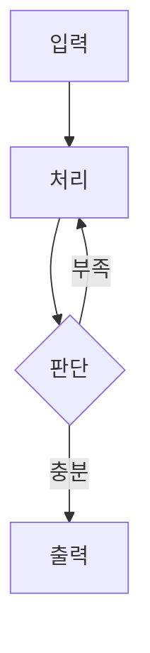

# TIL 작성 양식

기준 문서: 노션 `26.10.08 54일차(Database · PostgreSQL · ERD 및 SQL 작성 실습)`, 레포 `2026_10_07_Day53(Database_Design_Normalization_ERD).md`.

## 전체 골격

```markdown
# 26.10.08 54일차(주제A · 주제B · 주제C)        ← md 파일에만. 노션은 페이지 title로.

## [TIL] 오늘 한 일을 한 문장으로 요약하기

오늘은 ~을 했다. **핵심 키워드**를 중심으로 ~을 정리했다.
(1~3문장. 무엇을, 무엇을 기준으로, 어떤 결과까지 했는지)

이론과 실습은 다음 흐름으로 이어졌다.

```plain text
첫 번째 단계
→ 두 번째 단계
→ 세 번째 단계
```

---

## 1. 첫 번째 대주제

### 1-1. 소주제        ← 실습/화면처럼 순서가 있으면 번호, 개념 나열이면 `### 개념명(English Term)`

설명 문단...

---

## 2. 두 번째 대주제
...

---

## N. 헷갈린 점

처음에는 ~라고 생각했다. 하지만 ~이므로 ~했다.  ← 1인칭 회고형, 잘못 생각한 것 → 바로잡은 이유
(필요하면 코드 한 줄이나 흐름 코드블록으로 근거 제시)

---

## 추가!

오늘 배운 것 정리

- 한 줄 요약 bullet (6~10개)
- ...

~할 때는 다음 순서로 생각하면 된다.

```plain text
단계 1
→ 단계 2
→ ...
```

#부트캠프 #멀티캠퍼스부트캠프 #AI캠퍼스 #AI에이전트엔지니어
```

## 세부 규칙

**제목 / 섹션**
- 대주제 `## 1.`, `## 2.` … 아라비아 숫자 + 마침표. 소주제는 `### 1-1.` 또는 `### 개념명(English)`.
- 대주제 사이에는 반드시 `---`.
- 고정 섹션: 맨 앞 `## [TIL] …`, 끝에서 두 번째 `## N. 헷갈린 점`, 맨 끝 `## 추가!`. 입력에 헷갈린 점 단서가 없으면 혼동하기 쉬운 지점을 일반적인 확인 사항으로 정리한다. 사용자가 실제로 잘못 생각했거나 겪은 일처럼 1인칭 경험을 지어내지 않는다.

**문체**
- 평서체 "~했다 / ~이다 / ~한다". 경어체·이모지 금지.
- 개념 처음 등장 시 `한글(English)` 병기. 예: 기본키(Primary Key).
- 한 문단 1~3문장. 긴 설명은 표나 bullet으로 쪼갠다.

**강조**
- 핵심 개념 **굵게**, 테이블·컬럼·함수·파일명·명령어는 `인라인 코드`.

**표**
- 개념 비교, 매핑(한글↔영문), 조건·의미·예시 정리는 표로. 헤더 행 필수.
- 흔한 열 구성: `| 구분 | 의미 | 예시 |`, `| 조건 | 의미 |`.

**코드블록**
- 언어 태그 필수: `sql`, `python`, `bash`, `json` … 흐름도·경로·출력 결과는 `plain text`.
- 흐름도는 한 줄에 한 단계, 둘째 줄부터 `→ ` 로 시작.
- 코드가 길면 `### 3-1.`, `### 3-2.` 처럼 소주제로 나눠 코드블록을 분할.
- 코드 앞에 "왜 이렇게 했는지" 1~2문장을 먼저 쓴다.
- 입력 자료에 코드가 있으면 주요 함수 정의·호출부·설정값·실행 명령 중 핵심을 실제 자료에서 발췌한다.
- 코드 뒤에 코드의 역할, 입력·출력, 주의점을 자료에서 확인 가능한 범위로 정리한다.
- 코드 출처 파일과 함수명을 명시한다. 예: `` `pipeline/agent.py`의 `create_agent()` ``.

**흐름도·시각화**
- 단계가 3개 이상 연결되거나 분기·반복·에이전트 호출이 있으면 Mermaid와 plain text 흐름도를 함께 추가한다.



```plain text
입력
→ 처리
→ 판단
→ 충분하면 출력 / 부족하면 재처리
```

- Mermaid 노드명은 실제 파일·함수·도구명과 맞추고 입력에 없는 단계를 추가하지 않는다. 티스토리에서는 Mermaid 대신 인라인 스타일의 박스와 화살표로 변환한다.

**이미지**
- `### 소주제` 아래 이미지 → 그 아래 이미지가 보여주는 것과 필요한 데이터를 1~2문장으로 설명.
- 이미지 파일이 있으면 화면·도식·로그·결과를 직접 확인하고, 본문 텍스트 및 코드 흐름과 대조한다.
- 이미지에서 확인되는 추가 단계, 분기, 설정값, 실행 결과, 오류 또는 개선점은 해당 소주제와 전체 흐름도에 반영한다. 단순히 이미지 링크만 추가하지 않는다.
- 이미지에 보이는 정보만 사용한다. 판독이 불가능한 부분은 추측하지 말고 `[이미지 확인 필요]`로 표시한다.
- 이미지는 관련 코드·흐름도·결과 설명 바로 아래에 배치하며, 캡션에는 `무엇을 보여주는지`와 `흐름의 어느 단계인지`를 함께 적는다.

**결과 확인 섹션 (실습일 때)**
- `## N. 조회 결과 확인` 같은 섹션에 bullet로 "조건 → 실제 값"을 구체적 숫자와 함께 적는다.
- 결과가 있는 실습은 반드시 `결과 해석`을 추가한다. 최소한 `비교 대상`, `측정값`, `선택한 결과`, `선택 이유`를 포함한다.
- 선택 이유는 결과와 직접 연결한다. 예: `Hybrid의 MRR이 0.809로 가장 높아 일반 질문에 선택했다.`
- 결과 차이가 발생한 원인이 자료에 있으면 `원인 → 관찰된 결과 → 대응 → 영향` 순서로 정리한다. 원인이 확인되지 않았으면 `원인 미확인`이라고 명시한다.
- 오류나 실패 사례는 숨기지 말고 다음 표 형식으로 정리한다.

| 현상 | 원인 | 대응 | 결과 또는 다음 확인 |
|---|---|---|---|
| 실제 자료의 오류 | 확인된 원인 | 적용한 수정 | 수정 후 결과 / 재검증 필요 |

- 평가 결과가 설계 선택으로 이어지면 흐름도에도 반영한다.

```plain text
실험 조건
→ 결과 비교
→ 원인 분석
→ 설계 선택
→ 다음 실험 또는 구현
```

**해시태그 (고정)**
`#부트캠프 #멀티캠퍼스부트캠프 #AI캠퍼스 #AI에이전트엔지니어`


